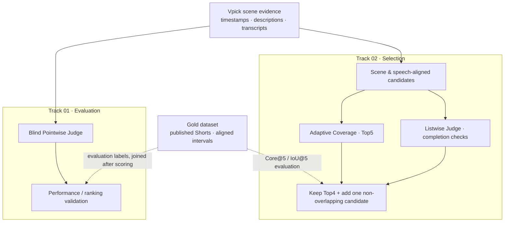

<div align="center">

# 🎬 Vpick

### Evidence-grounded LLM Evaluation & Short-form Highlight Selection

**From scene-level evidence to more reliable highlight candidates.**  
롱폼 영상에서 *좋은 숏폼 구간을 어떻게 평가하고 선택할 것인가*를 실험합니다.


[Overview](#overview) · [Results](#results) · [System Design](#system-design) · [Reproduce](#reproduce) · [Research Notes](#research-notes)

</div>

---

## Overview

숏폼 자동 생성에서 어려운 문제는 **많은 장면을 찾아내는 것**이 아니라, *실제로 볼 만한 장면을 고르고 그 선택이 좋은지 검증하는 것*입니다.

이 프로젝트는 기존 **Vpick의 장면 분석 결과**(scene description, transcript, timestamp)를 활용해 두 작업을 수행합니다.

| Research track | 핵심 질문 | 구현 |
|:--|:--|:--|
| **01 · LLM Evaluation** | LLM이 매긴 숏폼 품질 점수는 실제 성과와 얼마나 일치하는가? | Gold 데이터 구축, Blind Pointwise Judge, 성과 정합성 및 편향 검증 |
| **02 · Highlight Selection** | 공개된 숏폼의 핵심 구간을 더 잘 찾을 수 있는가? | 후보 생성, Adaptive Coverage, Listwise Judge를 통한 제한적 후보 보완 |

> **Scope** — Vpick 자체의 영상 분석 모델을 개발한 프로젝트는 아닙니다. 영상 분석 이후의 **평가체계, 후보 선택 파이프라인, 비교 실험**을 구축했습니다. 원본 YouTube 영상이나 MP4는 저장소에 포함하지 않습니다.

## Results

### Highlight selection · Development comparison

<div align="center">

**Core@5: 5.6% → 55.6%**  
Vpick baseline 대비 **+50.0%p** (개발 표본 기준)

</div>

| Selection strategy | Core@5 | Best IoU@5 | 무엇을 바꿨나 |
|:--|--:|--:|:--|
| Vpick baseline | 5.6% | 0.060 | 기존 자동 추천 |
| LLM Judge-only | 22.2% | 0.181 | LLM이 후보 5개 선택 |
| Adaptive Coverage | 50.0% | 0.361 | 영상의 여러 시간대를 고르게 탐색 |
| **Coverage Top4 + Judge 1** | **55.6%** | **0.405** | 기존 4개를 보존하고 비중복 후보 1개만 보강 |

**Core@5란?** 추천한 상위 5개 구간이 실제 공개된 숏폼의 **핵심 장면을 충분히 포함하는지**를 확인하는 지표입니다. 조회수 예측 정확도가 아닙니다.

**평가 범위:** 동일 조건에서 비교 가능한 **17개 롱폼·18개 Gold 구간(common18)**. 이 개선 방식은 일부 정답 구간을 이미 확인한 **비블라인드 개발 실험**에서 선택되었습니다. 새로운 영상에 대한 독립적 일반화 성능으로 주장하지 않습니다.

[실험 보고서 →](https://github.com/Ai-pre/Vpick/blob/codex/improvement-listwise-v2/reports/improvement_pipeline_v2_2026-07-29.md) · [파이프라인 설정 →](https://github.com/Ai-pre/Vpick/blob/codex/improvement-listwise-v2/config/best_improvement_pipeline.json)

### Evaluation · What the numbers actually mean

| Item | Result / Finding |
|:--|:--|
| Evaluation dataset | **85** long-form videos · **94** published Shorts · **6** channels |
| Performance groups | HIGH 30 / MID 34 / LOW 30 |
| Leakage prevention | Same-longform samples grouped together; dev **19** / locked test **75** |
| Judge validation | 품질 채점의 반복성과 실제 조회 성과 정합성은 **별도로** 검증 |
| Sanity check | 단순 HIGH/LOW 판정기조차 높은 상관을 얻을 수 있어, 단일 상관지표만으로 성능을 주장하지 않음 |

개발용 성과 보정기와 **조회수 예측에 활용할 수 있는 검증된 모델**은 다릅니다. 모델·집계식을 개발 데이터에서 선택한 결과는 별도의 외부 검증이 필요합니다.

> **External validation is pending.** 별도 v10 + v14 Judge-guided 파이프라인의 첫 신규 롱폼 파일럿(1개 Gold)은 **4개 비교 방식 모두 Top5 적중에 실패**했습니다. 이 결과도 그대로 공개하며, 개발 결과를 배포 성능으로 포장하지 않습니다. [Pilot evidence →](results/judge_guided_improvement_v1/ootb_fresh_pilot_PUBLIC.json)

## System Design



**Why this design?** 처음에는 Judge가 후보 5개를 모두 고르면 더 좋을 것이라 기대했습니다. 그러나 **Judge-only(22.2%)가 Adaptive Coverage(50.0%)보다 낮았습니다.** 그래서 안정적인 시간대별 선택을 유지하고, LLM은 기존 방법이 놓친 장면을 보완하는 데만 사용했습니다.

### What I implemented

- **Data & labels:** 실제 Shorts와 원본 롱폼의 시간 구간 정렬, 데이터 신뢰도 점검 및 동일 영상 간 데이터 누수 방지
- **LLM-as-a-Judge:** 후보 장면·대사·전후 문맥을 활용한 blind pointwise 평가, 프롬프트·반복성·평가 지표 검증
- **Candidate selection:** scene/발화 경계 기반 30·45·60·75초 후보, 유사 구간 압축, timeline coverage 및 constrained reranking
- **Analysis:** Core@K, Tight@K, IoU@K와 성과 순위 지표를 분리하고 실패한 접근도 함께 기록

## Reproduce

Python **3.10+** 기준. 대부분의 기본 평가 코드는 Python 표준 라이브러리를 사용합니다.

```bash
git clone https://github.com/Ai-pre/Vpick.git
cd Vpick

# 기본 평가 로직 단위 테스트
python -m unittest discover -s tests -p "test_evaluate_predictions.py" -v
```

이미 준비된 Gold CSV와 예측 결과 CSV가 있다면 다음 명령으로 구간 성능을 평가할 수 있습니다.

```bash
python src/evaluate_predictions.py \
  --dataset /path/to/gold_pairs.csv \
  --predictions /path/to/predictions.csv \
  --out-dir /path/to/evaluation_output
```

**전체 파이프라인 재실행에는** 공개 저장소에 포함되지 않은 Vpick 장면 원본, Gold 데이터 일부, 외부 LLM API 인증정보 등이 필요할 수 있습니다. 민감한 계정 정보와 원본 영상은 게시하지 않습니다. 개발 과정의 자세한 명령과 제한 조건은 아래 실험 문서를 참고하세요.

## Repository Guide

| Where | What you'll find |
|:--|:--|
| [`src/`](src/) | 후보 생성, LLM 평가, 리랭킹, 성능 평가 코드 |
| [`config/`](config/) · [`prompts/`](prompts/) | 평가 프로토콜, 모델 및 프롬프트 설정 |
| [`tests/`](tests/) | 데이터 처리·평가·후보 선택에 대한 테스트 |
| [`results/`](results/) · [`reports/`](reports/) | 공개 가능한 실험 결과와 해석 보고서 |
| [`docs/`](docs/) | 실험 설계, 실패 사례, 재현 조건 |
| [Highlight improvement v2](https://github.com/Ai-pre/Vpick/tree/codex/improvement-listwise-v2) | **Core@5 55.6%**를 기록한 개발용 선택 개선 코드 및 설정 |

## Research Notes

이 프로젝트에서 가장 크게 배운 점은 **“LLM이 만든 높은 점수”와 “실제로 더 나은 선택”은 다르다**는 것입니다. 평가의 허점을 찾아내고, LLM이 기존 선택기를 반드시 대체해야 한다는 가정을 버리는 것이 핵심적인 개선으로 이어졌습니다.

- [Highlight improvement · 상세 보고서](https://github.com/Ai-pre/Vpick/blob/codex/improvement-listwise-v2/reports/improvement_pipeline_v2_2026-07-29.md)
- [LLM Judge 검증 프로토콜](docs/llm_judge_validation_protocol_2026-07-28.md)
- [Judge-guided 신규 파일럿과 한계](reports/judge_guided_improvement_v1_2026-07-29.md)
- [기존 README · 전체 실험 이력](docs/README_EXPERIMENT_ARCHIVE.md)
- [Notion 프로젝트 정리](https://app.notion.com/p/39306d3e4524801aadc9d65fd80e210b)

<details>
<summary><strong>Limitations & next steps</strong></summary>

- 데이터는 일부 채널에 집중되어 있어 새로운 채널·장르에서의 일반화는 아직 검증되지 않았습니다.
- Judge 입력은 Vpick의 장면 설명과 대사에 기반하며, 표정·음성 톤·실제 편집 효과를 직접 평가하지 못합니다.
- 조회수는 콘텐츠뿐 아니라 게시 시점, 채널 규모, 노출량의 영향을 받습니다.
- 개발 단계에서 고른 가중치·임계값은 독립된 신규 롱폼 홀드아웃에 고정 적용해 확인해야 합니다.
- 후속 연구에서는 사람 평가와 신규 데이터 기반 검증을 우선합니다.

</details>

---

<div align="center">

**Built to measure not only what an LLM prefers, but whether that preference actually works.**

[Portfolio](https://ai-pre.github.io/Ai-pre/) · [Source code](https://github.com/Ai-pre/Vpick) · [Project notes](https://app.notion.com/p/39306d3e4524801aadc9d65fd80e210b)

</div>
